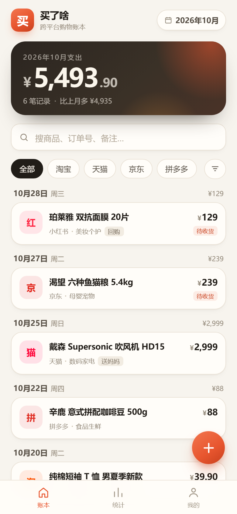
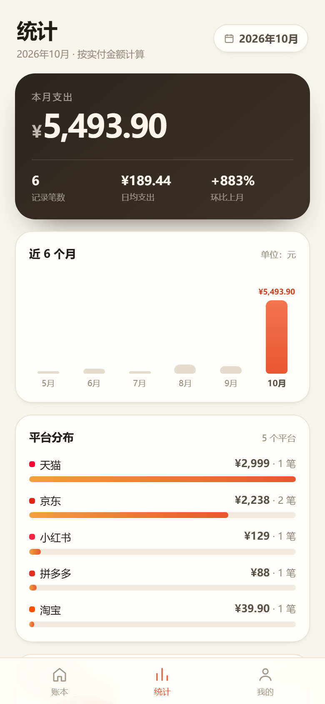
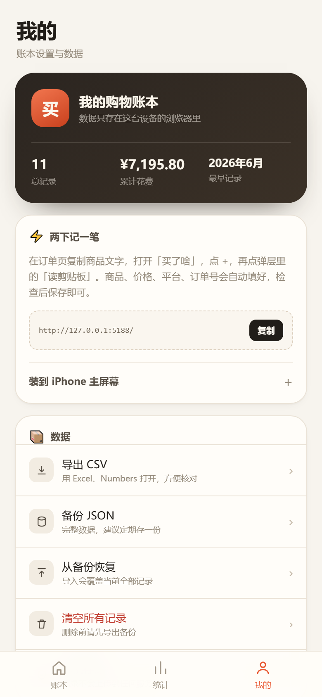

# 买了啥 · 跨平台购物账本

在淘宝、京东、拼多多、抖音、小红书……到处买东西，过一阵就忘了买过什么、花了多少钱、订单在哪。

**买了啥** 是一个装在 iPhone 主屏幕上的购物账本：复制订单文字，打开 App，点两下就能自动识别商品、价格、平台、订单号和日期。**数据只存在你的手机上，不依赖电脑，断网也能用。**

<p align="center">
  
  
  
  <br>
  <sub>界面预览（示例数据）</sub>
</p>

**在线地址**：<https://idrgr.github.io/maile-sha/>

---

## 现在能做什么

- **两下记一笔**：复制订单文字 → 打开 App → 点 `+` → 点「读剪贴板」，自动识别商品、金额、平台、订单号、日期和分类
- **找得到**：搜索商品名 / 订单号 / 备注，按平台、分类、状态筛选
- **算得清**：月度支出、环比、日均、平台分布、分类占比、近 6 个月趋势、本月最贵 Top 5
- **完全离线**：首次打开后，没有网络也能记账、看统计
- **数据在自己手里**：存在手机 IndexedDB，可导出 CSV、备份 JSON、从备份恢复
- **像 App 一样**：添加到 iPhone 主屏幕，全屏打开，没有地址栏

## 装到 iPhone

1. 用 **Safari**（不是微信内置浏览器）打开 <https://idrgr.github.io/maile-sha/>
2. 点底部「分享」按钮
3. 选「添加到主屏幕」
4. 以后固定从主屏幕图标打开

> **重要**：iOS 给主屏幕 App 和 Safari 分配了**互相独立的本地存储**。如果你先在 Safari 里记了几笔，再添加到主屏幕，那些记录不会自动出现在 App 里。请先安装，再开始记；或者固定只用一个入口。
>
> 第一次打开需要联网加载；之后断网也能用。

## 记一笔

1. 在淘宝 / 京东 / 拼多多 / 抖音的订单页，长按复制商品文字
2. 打开「买了啥」，点右下角 `+`
3. 点弹层里的「**读剪贴板**」——会自动识别并填好
4. 检查一下，点「保存」

金额或日期没识别出来时可以直接改。手动粘贴订单文字再点「识别」也可以。

### 为什么不用快捷指令直接写入？

iOS 的主屏幕网页 App 拥有独立存储。快捷指令（或在 Safari 里打开的链接）写入的是另一份数据，和主屏幕 App 里的账本不是同一个数据库，容易造成「记了但 App 里没有」。

所以这里把「读剪贴板」做进了 App 内：复制订单文字后，打开 App 点两下即可，数据始终落在同一个地方。

## 数据与备份

- 数据位置：iPhone 浏览器的 IndexedDB（不经过任何服务器，也不会上传）
- 「我的 → 导出 CSV」：用 Excel / Numbers 查看
- 「我的 → 备份 JSON」：完整备份，**建议每个月存一份到「文件」或网盘**
- 「我的 → 从备份恢复」：会覆盖当前全部记录
- 换手机：在旧手机备份 JSON，新手机安装后导入即可

> ⚠️ 删除 Safari 网站数据、卸载主屏幕 App、清理手机存储，都可能清空记录。JSON 备份是唯一可靠的后路。
>
> 在「我的 → 本机存储」可以看到当前占用的空间。

## 常见问题

**打开是白屏 / 打不开？**
第一次需要联网。确认用的是 Safari，iOS 16.4 或更高版本；如果刚更新过代码，下拉刷新一两次让 Service Worker 更新。

**数据会在 iPhone 和电脑之间同步吗？**
不会。这是刻意的设计：没有账号、没有云、没有服务器。需要迁移就用 JSON 备份。

**能记录退货吗？**
状态选「已退货」，统计时不会计入花费。

**识别得不准？**
尽量复制完整的订单文字（商品名、实付金额、订单号、下单时间）；识别结果都可以手动改。

**安全吗？**
仓库里只有网页代码，没有你的任何记录；数据只存在你手机的浏览器里。本项目不需要登录，也没有后端。

## 本地开发 / 自己部署

需要 Node.js 18+（只用于本地静态预览，App 本身不需要后端）。

```bash
npm start      # http://localhost:5188
npm test       # 解析与统计测试
```

> 用 `localhost` 打开时，数据存在电脑浏览器里，和手机上的数据互不相通，仅用于开发预览。

部署到 GitHub Pages：

```bash
git push origin main
git subtree push --prefix public origin gh-pages
```

Pages 的 Source 选择 `gh-pages` 分支根目录即可。所有资源都使用相对路径，因此可以部署在任意子路径下。

## 项目结构

```
public/            纯静态 App（可直接部署）
public/js/parse.js 订单文字解析
public/js/stats.js 筛选、月度统计、CSV
public/js/store.js IndexedDB 本地存储
public/app.js      界面与交互
public/sw.js       Service Worker（离线缓存）
src/server.js      本地静态预览服务器
test/              解析与统计测试
docs/              界面截图
```

技术栈：原生 HTML/CSS/JS + IndexedDB + Service Worker，零运行时依赖。
